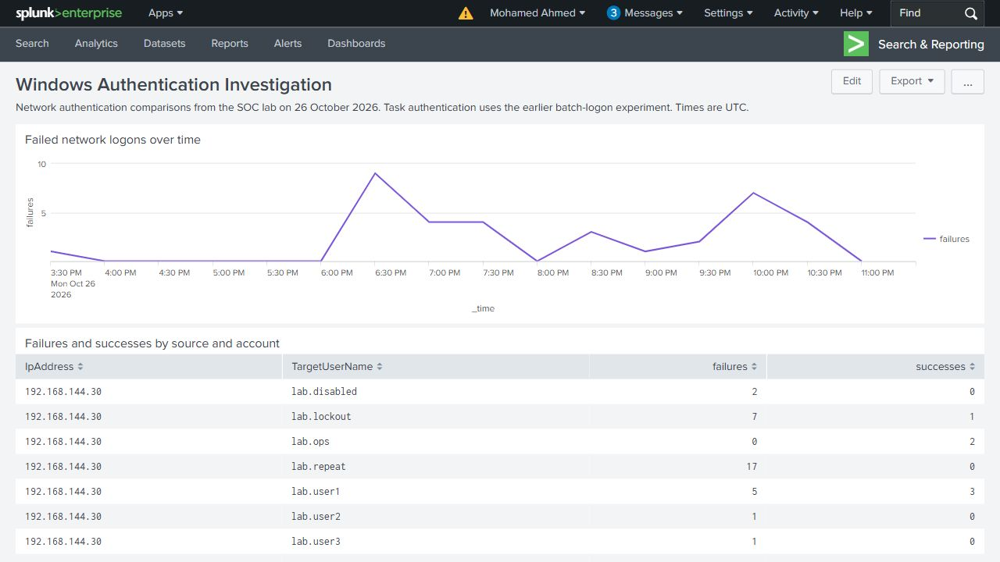

# Windows Authentication Investigation

A Windows domain lab for investigating password-guessing patterns and explaining authentication failures. Controlled cases compare repeated failures against one account, several accounts from one source, success after failure, account lockout and ordinary credential problems.

Used File Explorer and Active Directory interfaces for the network authentication comparisons, Task Scheduler for the batch-logon case, and Splunk Search for investigation. Windows events and interface pictures are linked in each case.

## Lab

| System | Role |
|---|---|
| SOC-DC01 | Windows Server 2022, Active Directory and DNS |
| SOC-WS01 | Windows Server 2022, source domain member |
| SOC-SRV01 | Windows Server 2022, target file server |
| SOC-SIEM | Splunk Enterprise 9.4.1 |

Domain: `soc.test` (`SOC`). All event times are UTC. [Lab setup](docs/lab-setup.md) - [Collection configuration](config/README.md)

## Investigations

| Case | Finding |
|---|---|
| [Normal sign-in](cases/case-A01/README.md) | One credential submission opened SOC-Share; source, validator and target records agreed |
| [Password correction](cases/case-A02/README.md) | A wrong password was rejected, then the corrected entry succeeded |
| [Repeated failures](cases/case-A03/README.md) | Two, three and four failures tested the five-minute threshold; spaced entries showed expiry |
| [Several accounts](cases/case-A04/README.md) | Four and five distinct accounts tested the ten-minute rule |
| [Failure then success](cases/case-A05/README.md) | The same-account success at 103 seconds matched; another account and a 918-second gap did not |
| [Lockout](cases/case-A06/README.md) | Lockout blocked a correct credential; administrative unlock restored authentication |
| [Disabled account](cases/case-A06-D/README.md) | Windows reported account disablement; the original enabled state was restored |
| [Scheduled task](cases/case-A07/README.md) | A saved credential became stale after a password change; task history separated this from a missing batch-logon right |

The network comparison contains 41 target logon records: 35 failures and 6 successes. These are event counts; Explorer sometimes retried a single credential submission. Supporting DC and source records are kept separately rather than added as extra attempts. The scheduled-task case has its own batch-logon timeline.

## Investigation results

| Test | Result |
|---|---|
| Repeated failures against one account | The moving five-minute search identified groups at and above the three-event threshold. All submissions in that case were rejected. |
| Several accounts from one source | The search identified five targeted accounts, matching the original target failure records. All five submissions were rejected. |
| Failure followed by success | The same-account success after 103 seconds matched the time condition. A different account and a 918-second gap did not. |
| Account state | Locked and disabled accounts produced distinct rejection reasons. Administrative unlock restored authentication in the lockout case. |
| Ordinary credential problems | Password correction explained one failure/success pair. The task comparison separated a missing logon right from a stale stored password. |

The repeated-failure and account-spread cases model password-guessing and password-spraying patterns. The known lab actions supply the test context; the Windows records establish the accounts, source, target, timing and outcomes. The normal and administrative comparisons help interpret similar-looking failures.

## Tested alert

The scheduled **Repeated authentication failures - lab validation** alert was tested against the recorded repeated-failure case. It triggered in Splunk, and its scheduled results and suppression behavior were checked. The other case investigations use saved searches and their result evidence. The [dashboard and alert page](docs/dashboard-and-alert.md) records that validation.

The existing failure/success case is a controlled correlation test. The correct password was deliberately supplied; its successful logon is separate from the repeated-failure experiment on lab.repeat.

## Searches and evidence

[Query guide](queries/README.md) - [Detection tests](docs/detection-validation.md) - [Dashboard and alert](docs/dashboard-and-alert.md) - [Master timeline](evidence/master-timeline.csv) - [Case summary](evidence/case-summary.csv) - [File hashes](SHA256SUMS.txt)
