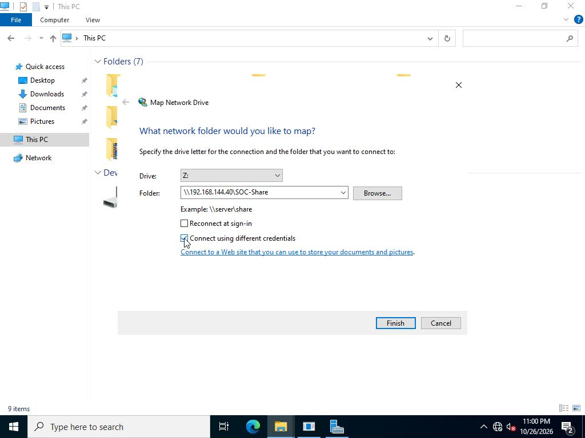
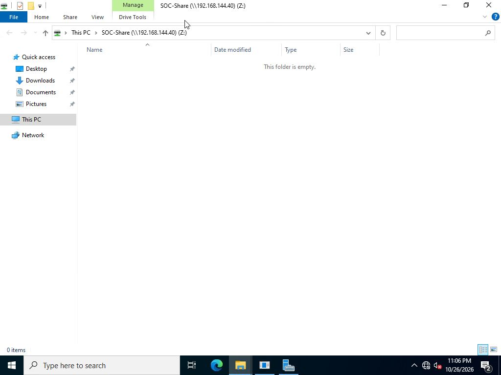
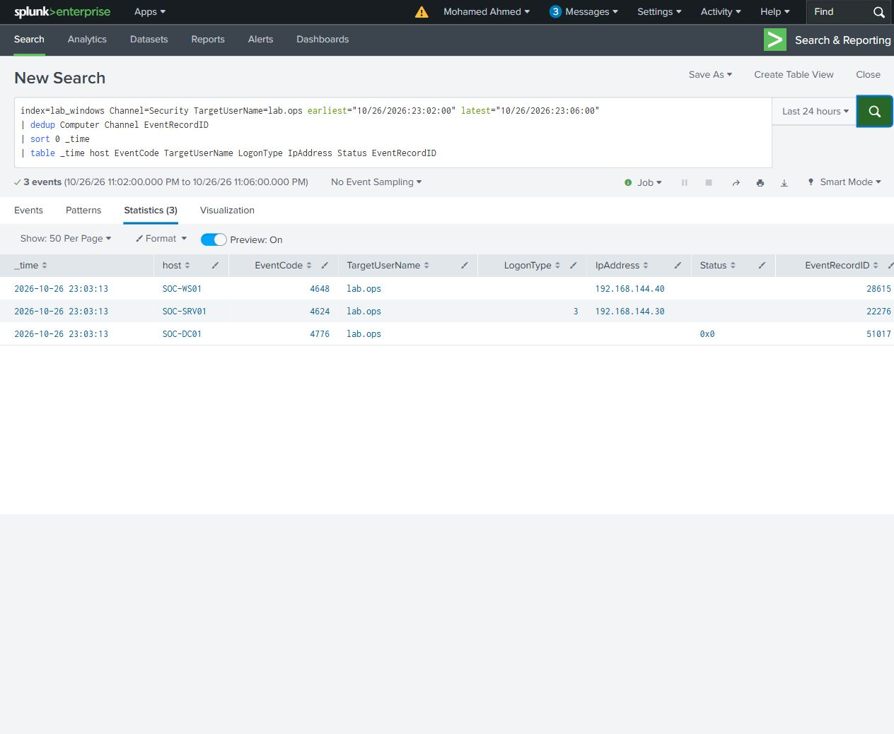

# Normal authentication

Connected from SOC-WS01 to SOC-SRV01 using File Explorer's Map Network Drive dialog and SOC\lab.ops. Saved credentials and reconnect at sign-in were unchecked. One credential submission opened the empty SOC-Share folder as drive Z:.

At 23:03:13 UTC on 26 October 2026, the source recorded explicit credentials event 4648/28615, the domain controller recorded successful NTLM validation 4776/51017, and the target recorded successful type 3 logon 4624/22276 from 192.168.144.30. Share-access events support the opened folder. This provides the normal network-authentication comparison; it is distinct from an RDP session.

[Search](normal-authentication.spl) - [Results](normal-authentication.csv)

[Timeline](timeline.csv) - [Original Windows events](selected-events/)
