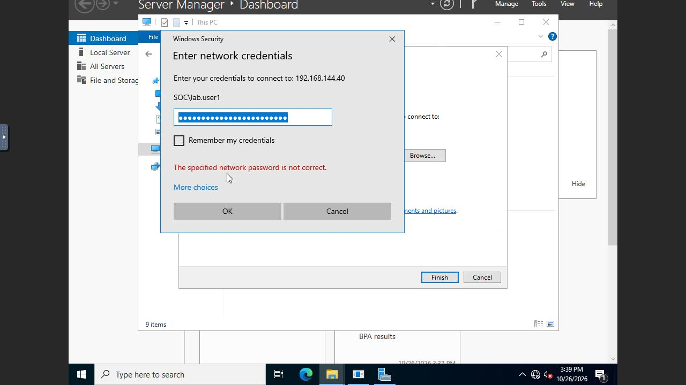
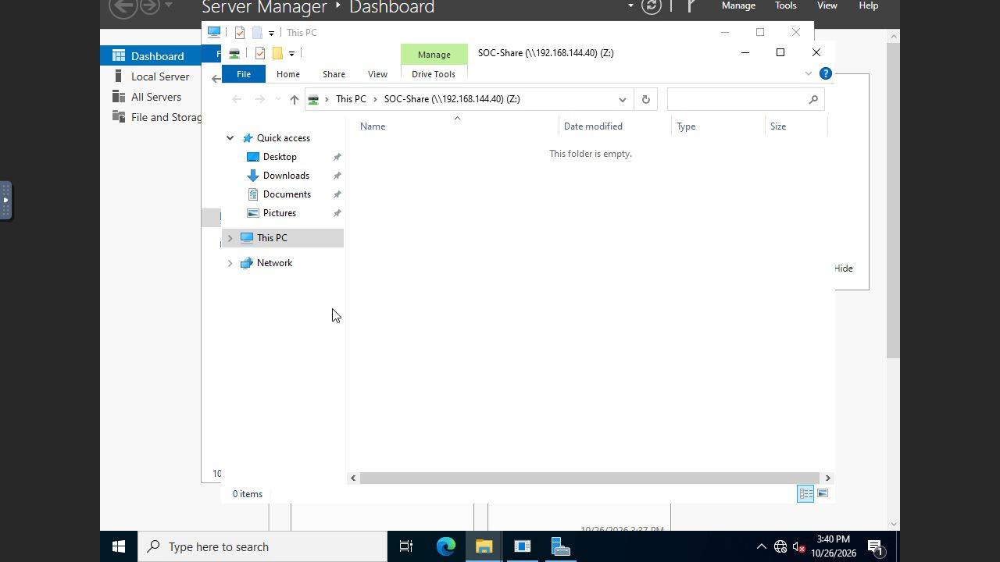
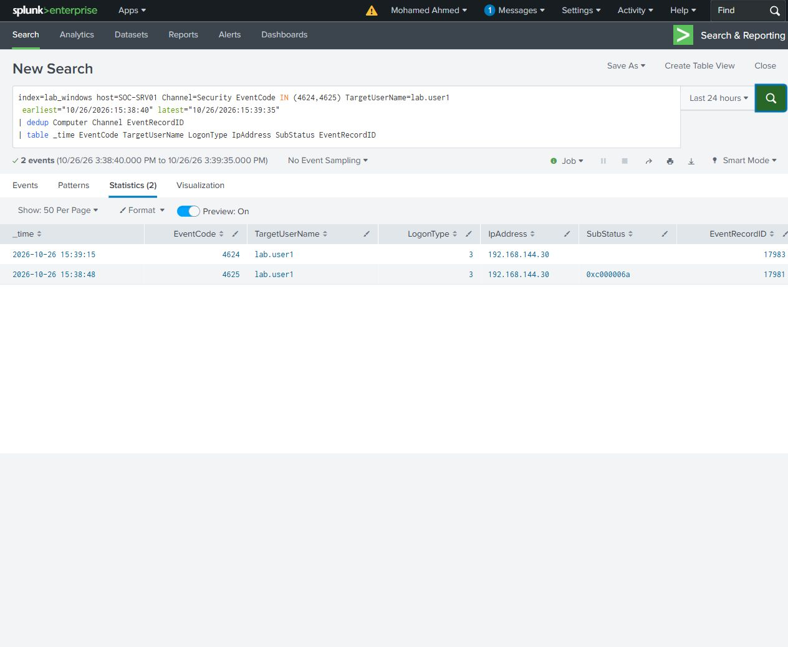

# Password correction

Connected from SOC-WS01 to SOC-SRV01 using File Explorer's Map Network Drive dialog and the dedicated SOC\lab.user1 account. The connection used different credentials, with saved credentials and reconnect at sign-in unchecked.

One wrong password was rejected. Entering the correct password in the same Windows credential dialog then opened SOC-Share as drive Z:.

| UTC, 26 October 2026 | Target event | Result |
|---|---|---|
| 15:38:48 | 4625 / record 17981 | Network logon rejected; bad-password substatus 0xc000006a |
| 15:39:15 | 4624 / record 17983 | Successful type 3 logon from 192.168.144.30 |

The source recorded two 4648 events and the domain controller recorded two 4776 validations. The selected original XML and timeline include the share-access records supporting the successful connection.

[Search](password-correction.spl) - [Results](search-results.csv) - [Timeline](timeline.csv) - [Original event XML](selected-events/)
