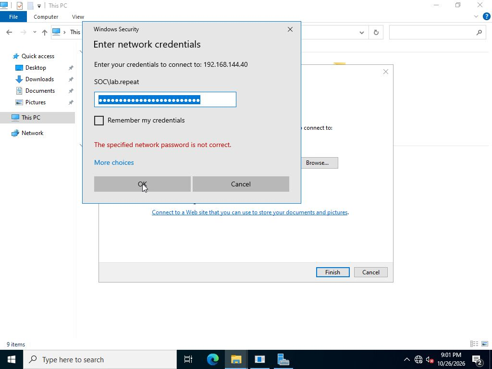
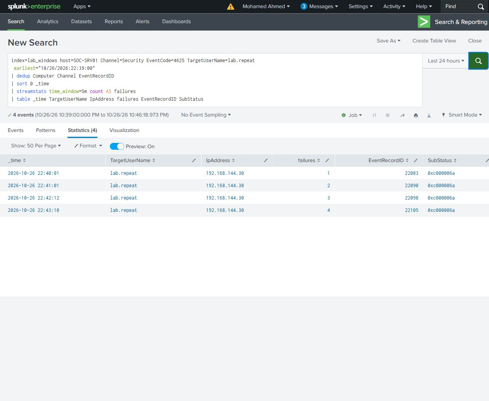

# Repeated password failures

Used File Explorer's network credential dialog on SOC-WS01 to submit individual incorrect passwords for SOC\lab.repeat against SOC-SRV01. Each rejected submission was captured from the Windows interface.

The search counts failures in the preceding five minutes. Two failures stayed below the three-failure threshold. Three failures reached it, and a separate four-attempt group exceeded it. Spaced attempts dropped out of the window, so the counter decreased even though the overall number of attempts increased.

All 17 target failures were type 3 network logons from 192.168.144.30 with bad-password substatus 0xc000006a. The target record IDs and rolling counts matched the original Windows records.

[Five-minute search](rolling-failures.spl) - [Search results](rolling-failures.csv)

[Timeline](timeline.csv) - [Original Windows events](selected-events/)
