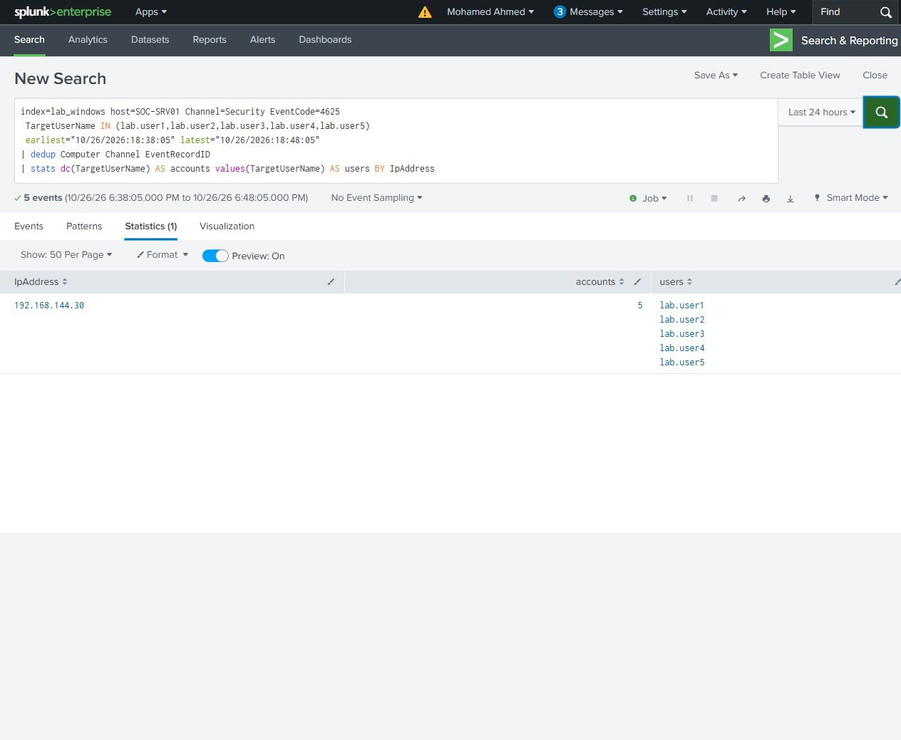

# Failures across several accounts

This controlled case models the account-spread pattern associated with password spraying and tests a distinct-account threshold.

Submitted one incorrect password for each of five lab accounts through File Explorer's credential dialog, all from SOC-WS01 to SOC-SRV01. The query groups by source address and counts distinct account names over ten minutes.

The first comparison returned four accounts; the next returned five. Later live searches returned five and then four as older attempts expired. Those later windows also include a real lab.user1 failure from the following comparison, which kept that account present after its initial attempt expired.

The distinct-account results matched the original target 4625 records. This pattern is useful for finding a source trying several accounts; the count alone does not establish malicious intent.

**Result:** the search identified all five targeted accounts from one source. The five submissions were rejected. Four-account and expiry comparisons checked when the rule should fall below its threshold. This case was verified through Search UI results; the project's scheduled alert test covers the separate repeated-account case.

[Four-account search](four-account-search.spl) - [Five-account search](five-account-search.spl)

[Timeline](timeline.csv) - [Original Windows events](selected-events/)
