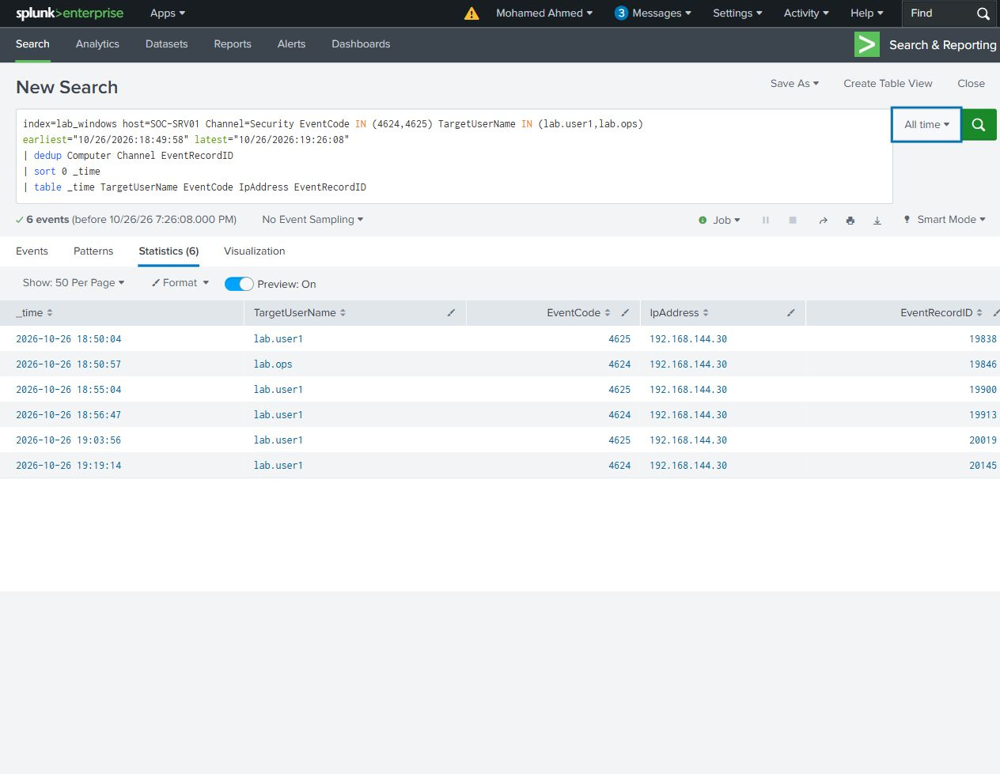
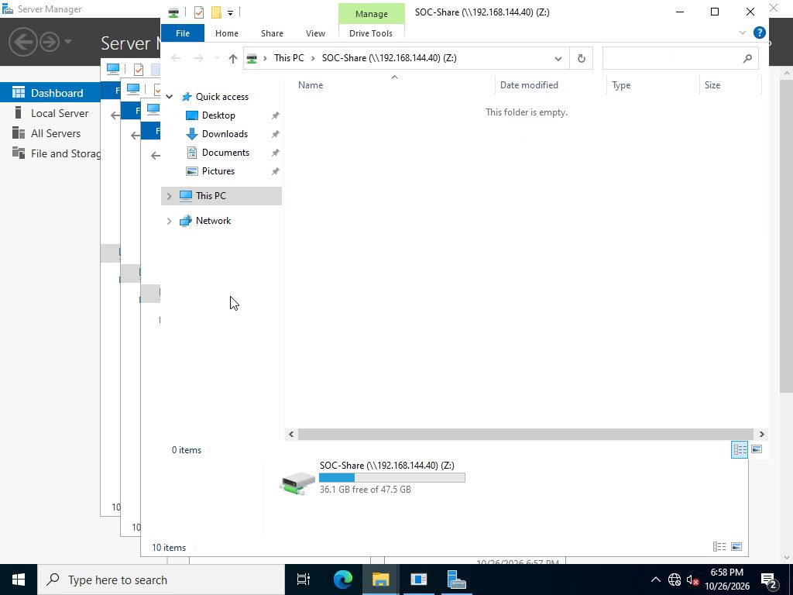

# Failure followed by successful access

Compared failed and successful network sign-ins to SOC-Share using File Explorer. Successful drive mappings were disconnected through Explorer before a fresh connection.

## Read the timeline

Start with the six target logons in time order. Event 4625 is a failure; 4624 is a success. Compare the account and source address before measuring the time gap.

```spl
index=lab_windows host=SOC-SRV01 Channel=Security EventCode IN (4624,4625) TargetUserName IN (lab.user1,lab.ops)
earliest="10/26/2026:18:49:58" latest="10/26/2026:19:26:08"
| dedup Computer Channel EventRecordID
| sort 0 _time
| table _time TargetUserName EventCode IpAddress EventRecordID
```

[Timeline search](authentication-timeline.spl) - [Six results](authentication-timeline.csv)



## Findings

| Successful account | Seconds since its preceding failure | Within five minutes? |
|---|---:|---|
| lab.ops | No preceding failure for that account | No |
| lab.user1 | 103 | Yes |
| lab.user1 | 918 | No |

There were six actual submissions: three rejections and three successful connections. The success by lab.ops belongs to a different account from the preceding lab.user1 failure. For lab.user1, the 18:55:04 failure and 18:56:47 success are 103 seconds apart. The next failure at 19:03:56 and success at 19:19:14 are 918 seconds apart, outside the five-minute condition.

The successful connections generated type 3 logons on SOC-SRV01. Source 4648 and domain-controller 4776 events support the credential submissions; share-access events support the successful mappings.



<details>
<summary>Optional: calculate the time gaps in SPL</summary>

The [comparison search](failure-then-success.spl) calculates the same gaps automatically. It records a failure time, carries the latest failure forward for each account and source with `streamstats`, then checks the gap at each success. `matched=yes` means that gap is no more than 300 seconds.

[Calculated results](failure-then-success.csv) - [Search screenshot](screenshots/A05-ordered-comparison-search.jpg)

</details>

[Timeline](timeline.csv) - [Original Windows events](selected-events/)
