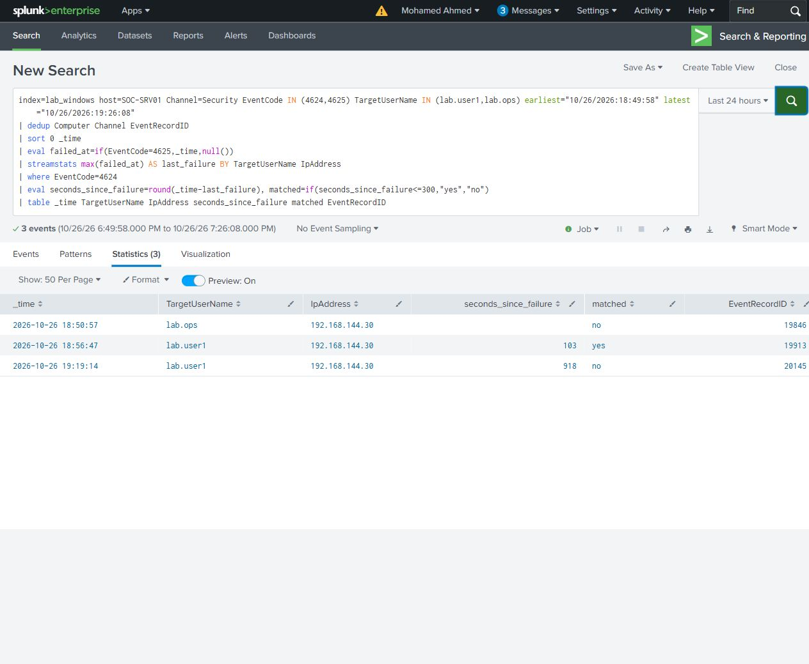

# Failure followed by successful access

Compared failed and successful network sign-ins to SOC-Share using File Explorer. Successful drive mappings were disconnected through Explorer before a fresh connection.

| Successful account | Seconds since its preceding failure | Within five minutes? |
|---|---:|---|
| lab.ops | No preceding failure for that account | No |
| lab.user1 | 103 | Yes |
| lab.user1 | 918 | No |

There were six actual submissions: three rejections and three successful connections. Grouping by both account and source prevents a success by lab.ops from being linked to lab.user1's failure. Sorting the events and carrying forward the last failure makes the time comparison visible without a transaction search.

The successful connections generated type 3 logons on SOC-SRV01. Source 4648 and domain-controller 4776 events support the credential submissions; share-access events support the successful mappings.

[Comparison search](failure-then-success.spl) - [Results](failure-then-success.csv)

[Timeline](timeline.csv) - [Original Windows events](selected-events/)
