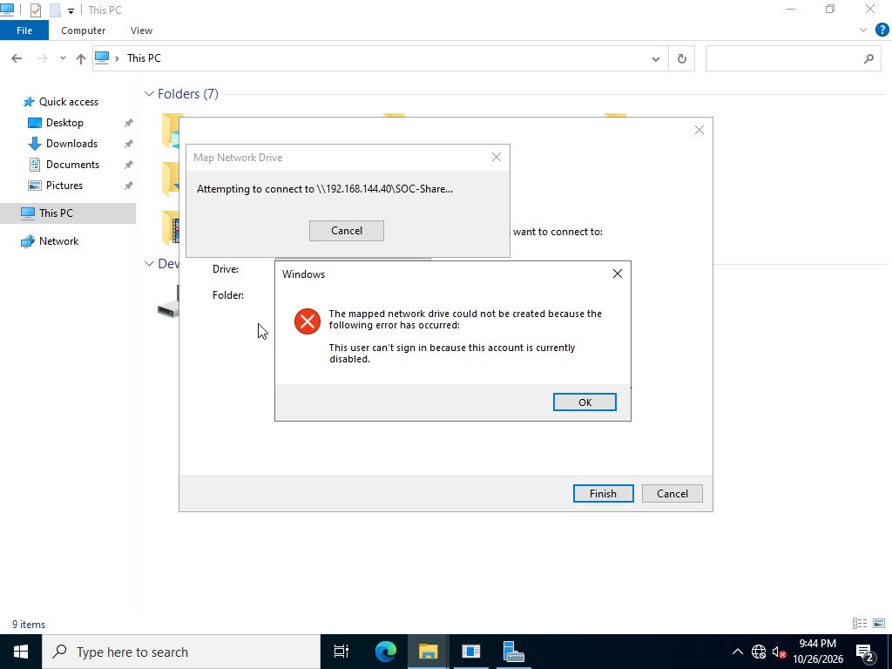
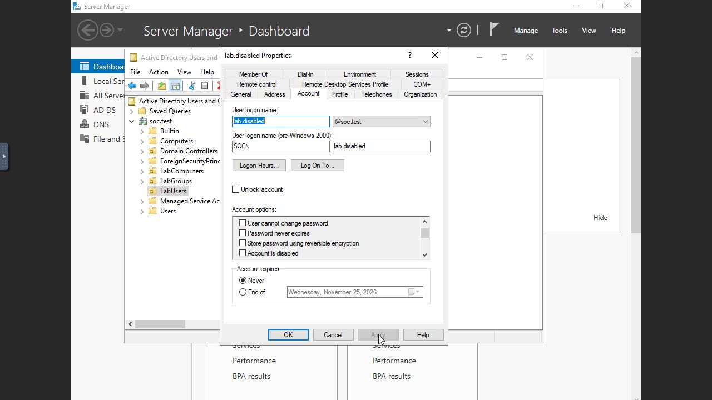

# Disabled account

Disabled SOC\lab.disabled in Active Directory Users and Computers, then submitted its saved credentials once through File Explorer on SOC-WS01. Windows rejected the connection because the account was disabled. The account was then restored to its original enabled state through the same properties dialog.

The domain controller recorded the disable and enable operations as 4725 and 4722. The target recorded two type 3 failures with disabled-account substatus 0xc0000072. Both came from one observed credential submission: Explorer retried internally. The two records are not two separate user attempts. DC 4776 validations also returned 0xc0000072; the target's local fallback 4776 records returned 0xc0000064.

[Search](account-state.spl) - [Results](account-state.csv)

[Timeline](timeline.csv) - [Original Windows events](selected-events/)
