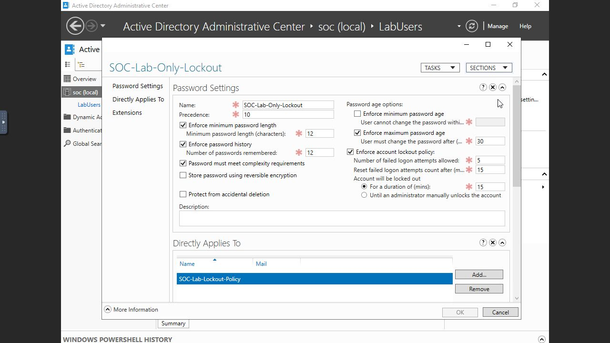
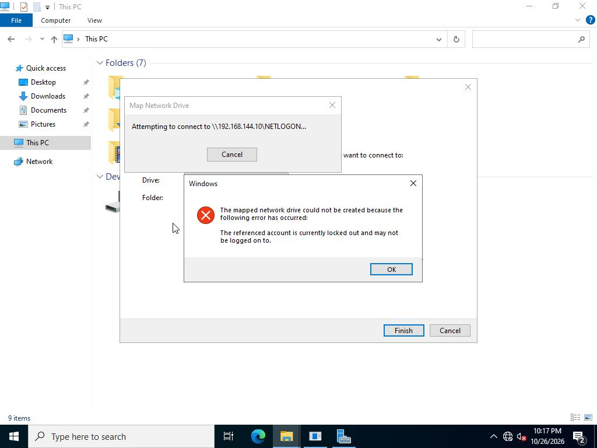
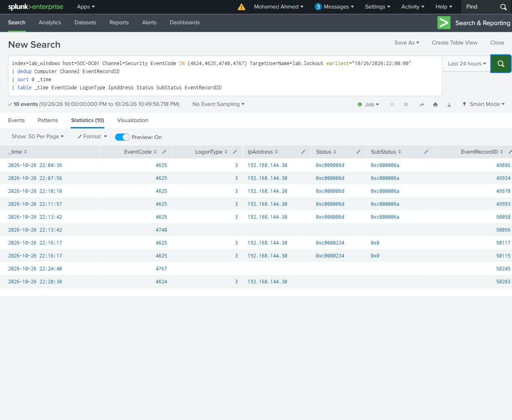

# Account lockout and recovery

Used the dedicated lab.lockout account from SOC-WS01 to test network authentication against SOC-DC01. Active Directory Administrative Center's resultant password settings showed the account's effective policy: five failures, a 15-minute observation window and a 15-minute lockout.

Five individual incorrect entries produced five bad-password failures. The fifth triggered DC event 4740 at 22:13:42 UTC on 26 October 2026. A subsequent correct-password submission was rejected while the account was locked, with status 0xc0000234. That single submission generated two target failures through Explorer's retry behavior.

Unlocked the account in Administrative Center. DC event 4767 at 22:24:40 records that administrative action. The next credential submission produced successful type 3 logon 4624/50283 at 22:28:30, supported by successful 4776 validation. Authentication succeeded after the unlock, while Explorer still returned Access is denied for NETLOGON. Authentication and share authorization were separate outcomes.

The final account state was enabled, unlocked and had a zero bad-password counter. No password or system-clock change was used for recovery.

[Main search](lockout-recovery.spl) - [Results](lockout-recovery.csv) - [Supporting timeline search](account-state.spl)

[Timeline](timeline.csv) - [Original Windows events](selected-events/)
