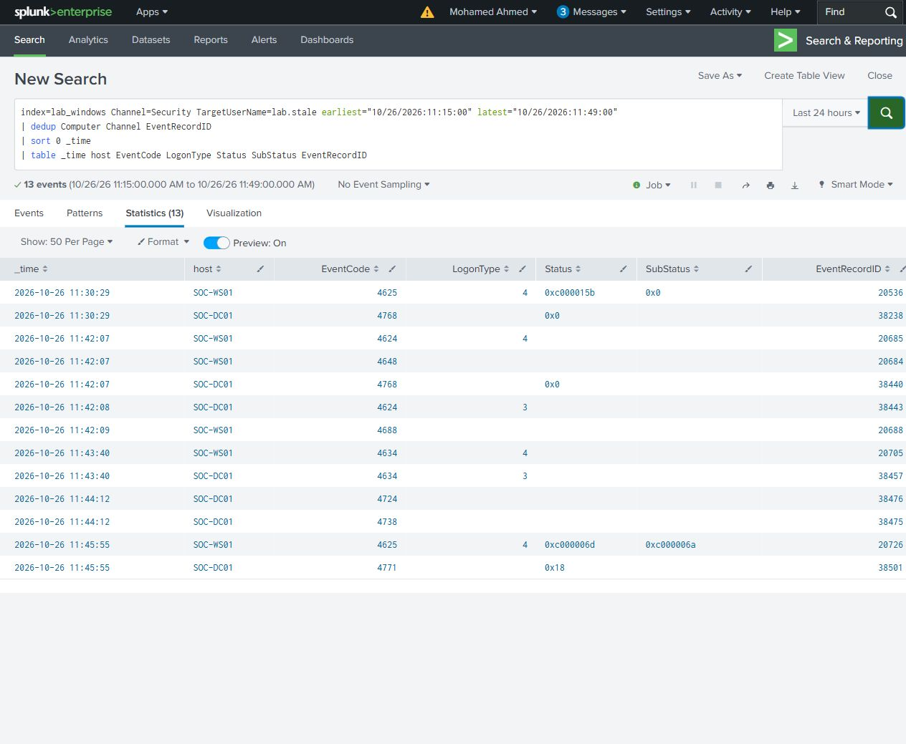
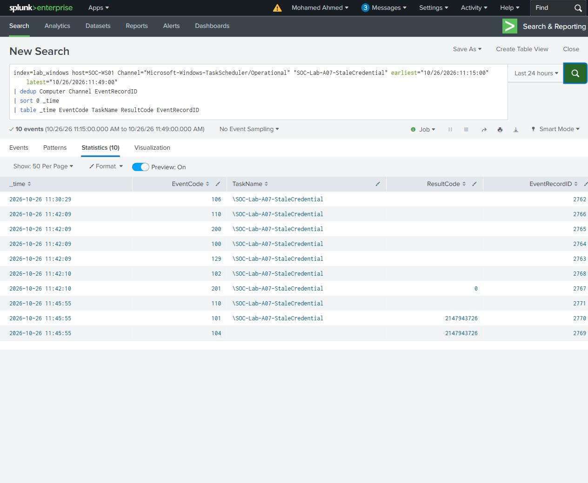
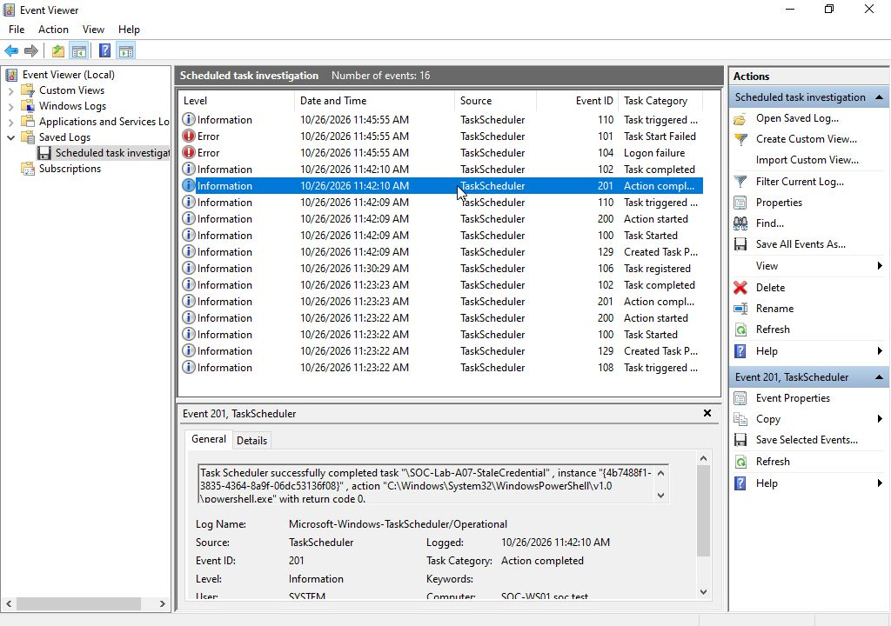
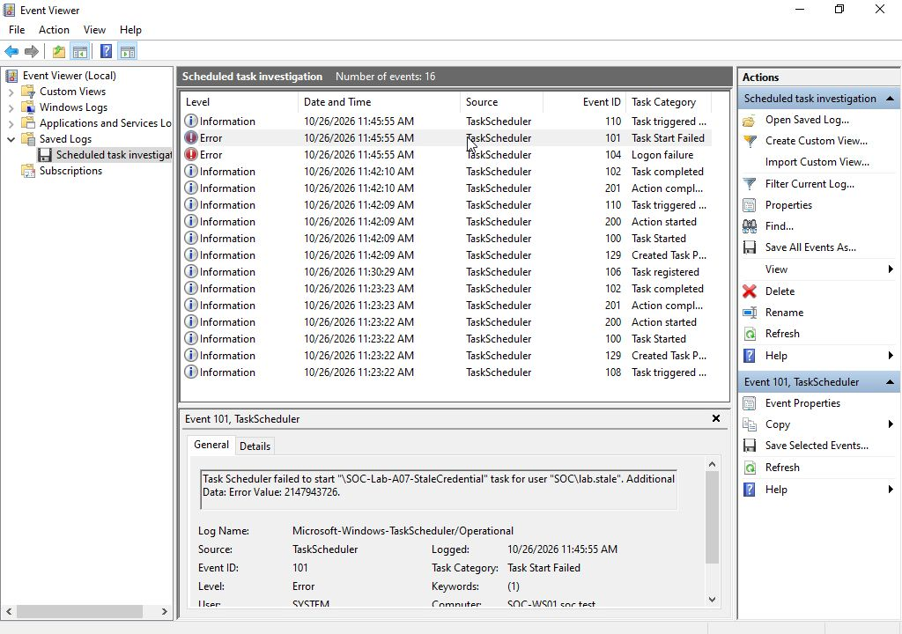

# Scheduled task authentication

Two searches answer separate questions. The authentication search shows source and domain-controller events for lab.stale. The Task Scheduler search shows the named task's run results.

The initial type 4 failure used status 0xc000015b: the account lacked the required batch-logon right. After that prerequisite was addressed, the task ran successfully and its action returned 0. Following the account's password change, running the task with its previously stored credential produced a bad-password type 4 failure, DC Kerberos status 0x18 and Task Scheduler result 2147943726 (0x8007052E). These are different failure causes.

The searches returned 13 matching Security records and 10 task-channel records. Task History and marker evidence support the run results.

[Authentication search](authentication.spl) - [Task result search](task-result.spl)

The on-demand task appended a timestamp to `C:\SOC-Lab\TaskEvidence\A07-marker.txt`. The successful batch logon was 4624/20685; process event 4688/20688 and Sysmon file event 11/23125 support its action. After the failed launch, the 48-byte marker retained its previous write time and SHA256.

[Timeline](timeline.csv) - [Original event XML](selected-events/)
