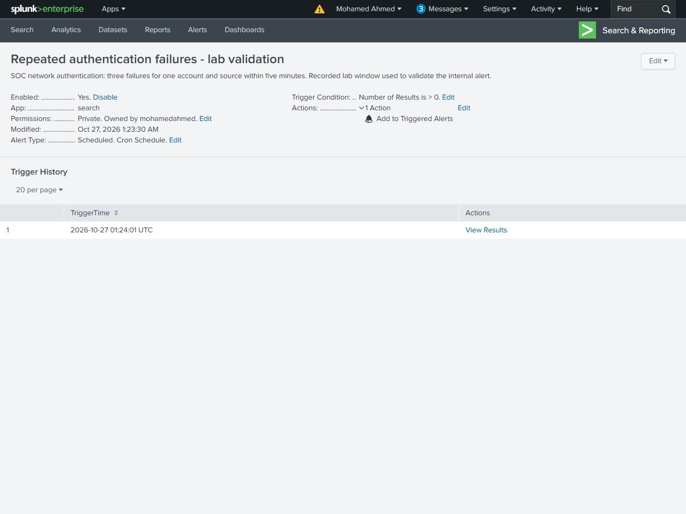
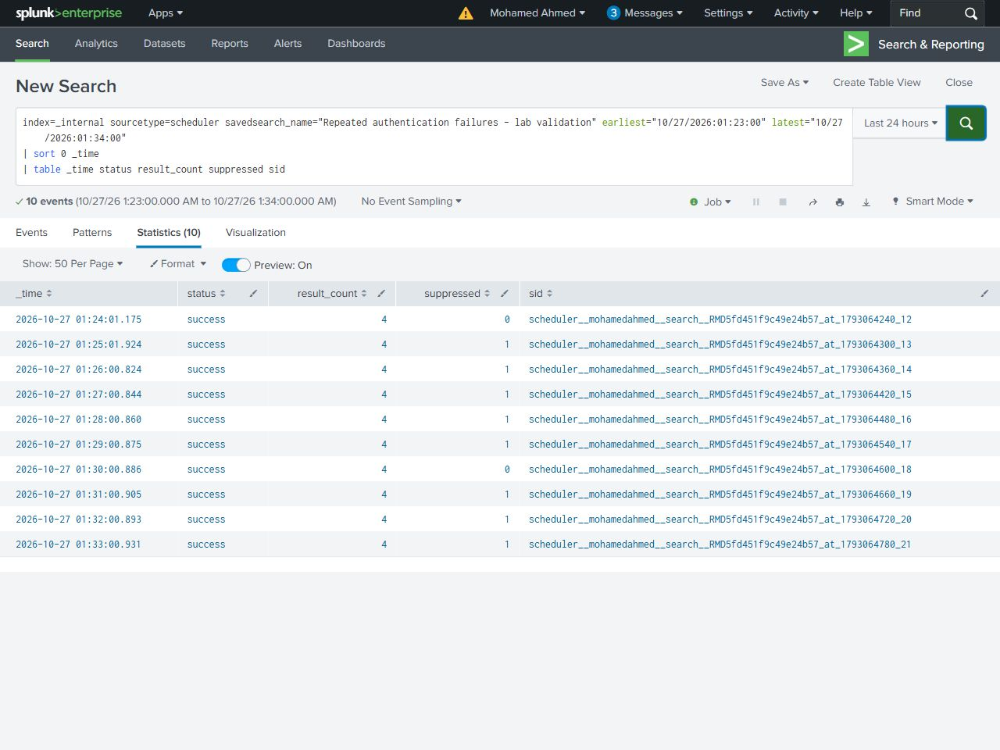

# Dashboard and alert

The saved Classic dashboard has a failure trend and eight investigation tables: source/account distribution, failure reasons, repeated-account candidates, account spread, success correlation, lockout recovery, disabled-account context and scheduled-task authentication. Its network totals match the original Windows records: 35 failures and 6 successes.

[Dashboard XML](../dashboard/authentication-investigation.xml) - [Full dashboard image](../dashboard/dashboard-full.jpg)

An internal scheduled alert used the repeated-failure rule against the recorded lab window. The rule returned four results. Trigger History showed its first alert at 01:24:01 UTC on 27 October 2026. Ten scheduler evaluations succeeded: two were unsuppressed and eight were suppressed with a five-minute throttle. [Scheduler results](../evidence/alert-scheduler.csv) and [original scheduler lines](../evidence/alert-scheduler-original.log) support the test. Scheduling stopped after validation.

The [saved settings](../config/repeated-failures-alert.json) retain the tested rule with scheduling off. The alert action adds an entry to Splunk's internal Triggered Alerts list.
