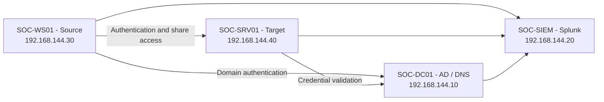

# Lab setup

## Systems

| Host | Role | Address | Software |
|---|---|---|---|
| SOC-DC01 | Active Directory and DNS | 192.168.144.10 | Windows Server 2022 Standard Evaluation, build 20348 |
| SOC-SIEM | Log collection and investigation | 192.168.144.20 | Splunk Enterprise 9.4.1 |
| SOC-WS01 | Source member | 192.168.144.30 | Windows Server 2022 Standard Evaluation, build 20348 |
| SOC-SRV01 | Target member | 192.168.144.40 | Windows Server 2022 Standard Evaluation, build 20348 |

The domain is `soc.test`, with NetBIOS name `SOC`. The members use the DC for DNS and domain authentication. Their machine identities and secure channels were checked after joining. Windows event times are recorded in UTC.

## Accounts and policy

Dedicated test accounts are `lab.user1` through `lab.user5`, `lab.repeat`, `lab.lockout`, `lab.disabled`, `lab.stale` and `lab.ops`. The setup administrator is separate.

`SOC-Lab-Share-Users` contains lab.user1 and lab.ops. It has Change access to the target's `SOC-Share` share, with Modify permission on `C:\SOC-Lab\RemoteShare`. Lab.user5 is outside this group. Lab.ops belongs to the target's local Administrators group through `SOC-Lab-Operators`.

The fine-grained policy `SOC-Lab-Only-Lockout` applies only to lab.lockout: five failures, a 15-minute observation window and a 15-minute lockout. The default domain lockout threshold is zero. Lab.disabled was temporarily disabled for its comparison and then re-enabled.

The source and target remain on the private lab network. New target rules for TCP 445 and 3389 are restricted to the source address. Network comparisons use File Explorer connections to SOC-Share on SOC-SRV01. The lockout comparison authenticates against NETLOGON on SOC-DC01; recovered authentication is distinct from its denied share access. The scheduled-task case runs on SOC-WS01.
